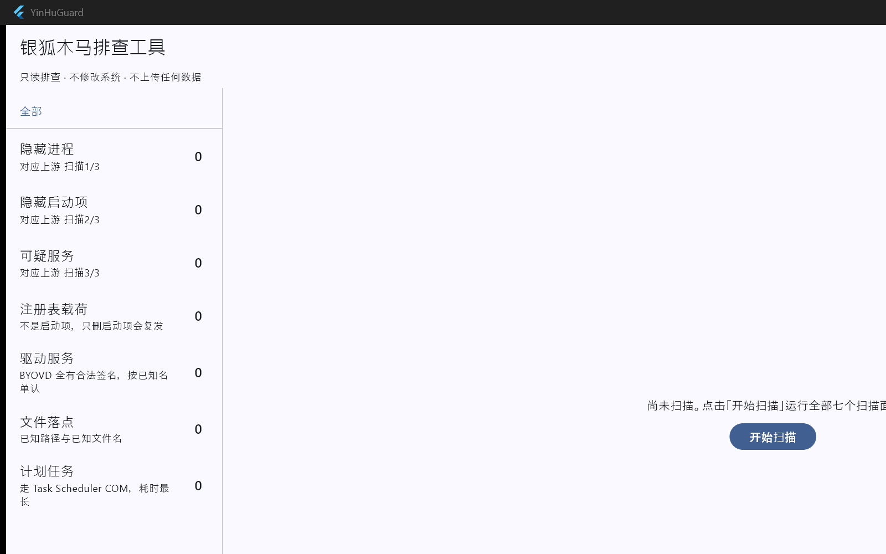

# YinHuGuard




YinHuGuard is a **read-only** Windows triage tool for the Silver Fox (ValleyRAT) trojan family.
It answers one question — *"is this machine compromised, and if so, where?"* — by scanning
**seven surfaces** in a single pass and reporting what it finds through a desktop GUI, a CLI,
a structured log, and JSON/CSV reports.

It never touches the system: no deleting, no unlinking, no registry writes, no stopping of
services or processes. Detection and reporting only, by construction.

The interface is in Chinese; every report artifact is plain text, JSON, or CSV.

---

## What It Does

- **Seven scan surfaces in one pass** — hidden processes, hidden Run keys, suspicious services, registry payloads, BYOVD driver services, file drops, and scheduled tasks. All seven run sequentially; none can be skipped.
- **A self-check panel that makes "no findings" trustworthy** — a four-state, mutually exclusive verdict (enumeration failure → permission gap → covered-what-could-be-covered → complete coverage), so an empty result never silently reads as "clean".
- **Automatic triage for whatever stays unreadable** — even an elevated scan cannot read everything. Those entries are cross-referenced by name against a built-in list of known Windows and vendor components, with the few that don't match flagged for human review. On the author's machine, 38 uncovered items reduced to a single one needing a look.
- **Four output channels, one computation** — GUI, log, CLI, and JSON/CSV reports all consume the same evaluated findings; no channel-specific logic.
- **Wording follows the elevation state** — the same `ACCESS_DENIED` says "run as admin" before elevation and "protected by the kernel" after it.
- **Redaction built in** — usernames and machine names become `<USER>` / `<MACHINE>` in every artifact; paths are kept for remote analysis.
- **No network activity, ever** — no uploads, no telemetry, no auto-update, no crash reporting.
- **Portable** — unzip and run. No installer, no runtime dependencies.

---

## The Seven Scan Surfaces

The first three surfaces originate from a widely-circulated batch script by
[@SYSTEM-RAMOS-ZDY](https://space.bilibili.com/493998035); the remaining four are deep-scan
surfaces added by this project, each backed by vendor threat intelligence.

| # | Surface | What it finds |
|---|---------|---------------|
| 1 | **Hidden Processes** | Executables carrying `hidden` or `system` file attributes |
| 2 | **Hidden Run Keys** | Run/RunOnce registry entries pointing to hidden files |
| 3 | **Suspicious Services** | Services launched via command interpreters, or binaries outside system directories |
| 4 | **Registry Payloads** | `HKCU\Console\` values with 32-hex names, plus `IpDates_sun`, `Magisk`, and `FaCai2024` markers. **These are not startup items** — but deleting only the startup item lets the payload come back on reboot |
| 5 | **Driver Services** | Known BYOVD driver names; `ImagePath` outside `System32\drivers`. Silver Fox uses these to kill protected processes from kernel mode — all carry valid signatures, so name matching is the only reliable method |
| 6 | **File Drops** | Known full paths; arbitrary `.sys` under `ProgramData`; 6-character alphanumeric random subdirectories under IE paths |
| 7 | **Scheduled Tasks** | Known task names; actions pointing into non-standard directories |

Deep-scan surfaces (4–7) move a full scan from seconds to minutes; scheduled tasks are the
slowest.

---

## The Self-Check Panel

The most important UI element. It exists to prevent the fatal misreading: *"no findings"
sounds like "the machine is clean."*

| State | Color | Meaning | Action |
|-------|-------|---------|--------|
| **Incomplete** | Red | Items exist that could not be checked due to permissions — elevation resolves this | Click 完整扫描（提权重跑） → UAC "Yes" |
| **Elevated: everything checkable was checked** | Blue | Elevated, no permission gaps; a few items remain unreadable (protected processes, race conditions) and are listed as 未覆盖 — this is the normal result | None; results are conclusive |
| **Coverage complete** | Blue | Elevated, zero permission gaps, zero uncovered items (rare on real machines) | None |
| **Enumeration failure** | Blue | Process/service enumeration returned zero — engine malfunction, results unusable | Re-scan; if persistent, re-extract a fresh copy |

The panel also shows raw counts: elevation status, process total, path-resolved count,
Session 0 visible count, service total, ImagePath-resolved count.

---

## Uncovered Item Triage

After elevation, dozens of items may remain unreadable. Rather than asking the user to
verify each one by hand, YinHuGuard cross-references every uncovered entry against a
built-in known-component list:

| Marker | Meaning | What to do |
|--------|---------|------------|
| **已知系统组件** (Known system component) | Name matches a Windows built-in process or driver | Ignore |
| **已知第三方组件** (Known third-party) | Name matches an identified vendor component (e.g. Intel PresentMon) | Ignore |
| **待人工核实** (Needs review) | Name not in the list | Identify it in Task Manager |

A summary line appears in the self-check panel — e.g. *"38 uncovered: 37 cross-referenced
against known components, 1 needs review"* — with per-item detail in the findings list.

**Two critical limitations:**

1. **Name-only matching.** Uncovered items are precisely the ones whose paths cannot be
   read, so no path, signature, or hash is available. Names can be spoofed. "Matched"
   means "the name is familiar", **not** "it is safe".
2. **Not a verdict.** Matched items stay visible, stay marked 未覆盖, and are never folded
   away. What cannot be read must not be hidden.

Triage appears only in the **elevated** view. Without elevation, unreadable items are
explained by the permission gap, not by identity.

---

## Quick Start

1. Download the latest `YinHuGuard-vX.Y.Z-win-x64.zip` from
   [Releases](https://github.com/yasunosubaru/YinHuGuard/releases) and extract it to a folder
   (do **not** run from inside the archive)
2. Double-click `YinHuGuard.exe`
3. Click **开始扫描** (Start Scan)

The program does **not** auto-scan on launch — a security tool that enumerates processes and
services before the user clicks anything is indistinguishable from malware.

Logs and reports are written to `reports/` beside the executable; if that location is not
writable (e.g. under `Program Files`), output falls back to `Documents\YinHuGuard`. A Chinese
first-run guide ships inside the zip as `README-zh.txt`.

### SmartScreen

This tool is **not code-signed** (individual certificates run ~$200/year), so SmartScreen
will flag it as an unknown publisher. To proceed: click **"More info"** → **"Run anyway"**.

If that dialog makes you uncomfortable, that is reasonable — a trojan-scanning tool deserves
suspicion. You can run CLI mode first, which produces the same reports without a GUI.

---

## CLI Usage

```powershell
YinHuGuard.exe --scan                 # Scan and print a summary
YinHuGuard.exe --json D:\report.json  # Scan and write a JSON report
```

Exit codes: `0` no findings, `10` findings present, `1` argument error, `2` engine error,
`3` config/engine not found.

---

## Building from Source

### Prerequisites

- [Flutter SDK](https://docs.flutter.dev/) (stable channel)
- [CMake](https://cmake.org/) ≥ 3.20
- Visual Studio 2022 or later with the C++ workload
- Windows SDK 10.0.22000.0+

### Build

```powershell
# Configure and build the C++ engine
cmake -S engine -B engine/build -G "Visual Studio 17 2022" -A x64
cmake --build engine/build --config Release

# Build the Flutter app
cd app
flutter build windows --release

# Package for distribution
cd ..
powershell -File package/build_package.ps1
```

### Project Structure

```
YinHuGuard/
├── engine/                  # C++ scanning engine (DLL) — all Win32 access
│   ├── include/             #   Public headers
│   ├── src/                 #   Implementation (7 scan surfaces)
│   └── tests/               #   CTest unit tests
├── app/                     # Flutter GUI application
│   ├── lib/
│   │   ├── ui/              #   Dashboard, self-check panel, findings table
│   │   ├── headless.dart    #   CLI entry point
│   │   ├── elevate.dart     #   UAC elevation logic
│   │   └── strings.dart     #   All user-facing copy
│   └── test/                #   Widget tests
├── lib/                     # Core library (pure Dart)
│   └── src/
│       ├── model/           #   Finding, Observation, SelfCheck
│       ├── criteria/        #   Evaluator, redaction
│       ├── triage/          #   Known-component matcher
│       ├── report/          #   JSON/CSV/log writers
│       └── scan/            #   Orchestrator
├── fixtures/                # Test data (synthetic machine states)
├── rules/rules.json         # Scan configuration (pure data, user-editable)
├── package/                 # Packaging script and distribution README
└── docs/                    # Design specs, implementation plans, screenshots
```

---

## Design Principles

1. **Read-only** — the tool never deletes, modifies, stops, or cleans anything. It reads
   and reports. Full stop.
2. **Never hide what cannot be read** — upstream batch scripts silently drop items they
   cannot access. YinHuGuard surfaces every unreadable item with an explicit reason, so
   "no findings" never becomes a false all-clear.
3. **One computation, four channels** — findings are evaluated once in the core library,
   then consumed identically by the GUI, log writer, CLI, and JSON report.
4. **Judgment follows elevation state** — an `ACCESS_DENIED` before elevation means "run as
   admin". The same error after elevation means "protected by the kernel". The wording,
   color, and flags all change accordingly.
5. **No permanent red** — a warning that is always on becomes invisible after two weeks.
   Residual items (race conditions, protected processes) are gray, not red. Only genuinely
   actionable gaps are red.
6. **Rules are pure data** — `rules.json` is the only user-editable configuration. It is
   never code, never executed, and malformed values cause startup rejection with a specific
   error.

---

## What It Doesn't Do

| Not included | Why |
|--------------|-----|
| Cleanup / remediation | Risk of damaging the system; the upstream script's destructive operations include deleting the volume shadow copy service |
| Process code-signature verification | Silver Fox injects into `svchost` / `winlogon` / `explorer`; signature checking is the only reliable defense against name-legitimate processes, but implementation is ongoing |
| Network IOC matching | Out of scope for a local triage tool |
| COM / TypeLib hijacking, DLL side-loading | No public evidence of Silver Fox using these; adding them would be noise |
| Winlogon hijacking (`Shell` / `Userinit`), IFEO, WMI event subscriptions | Same as above |

---

## Known Limitations

- **Heuristic detection** — false positives are expected. Normal software sometimes hides
  its files; vendor drivers and security tools often live outside `System32`. Findings need
  human confirmation before acting on them.
- **Name-only triage** — the known-component list matches names only. A spoofed name will be
  classified as "known". It is a triage aid, not a clearance.
- **Partial coverage** — the tool covers known Silver Fox techniques. New variants, changed
  indicators, and novel techniques will not be detected. **"No findings" does not mean "not
  compromised."**

If you suspect an active compromise:

1. Run this tool elevated to identify obvious traces
2. Run a full scan with a reputable antivirus
3. If the antivirus itself cannot open, the compromise is deep — consider reimaging

---

## Contributing

Bug reports, feature requests, and pull requests are welcome — please open an issue before
submitting large changes. Issues in Chinese or English are both fine.

## License

[MIT](LICENSE)

## Credits

Tool design and implementation: this project. The scan methodology and the first three
surfaces come from [@SYSTEM-RAMOS-ZDY](https://space.bilibili.com/493998035).
